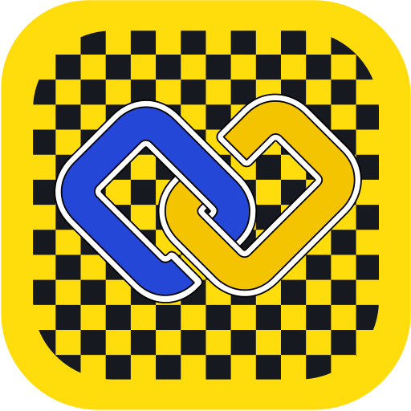
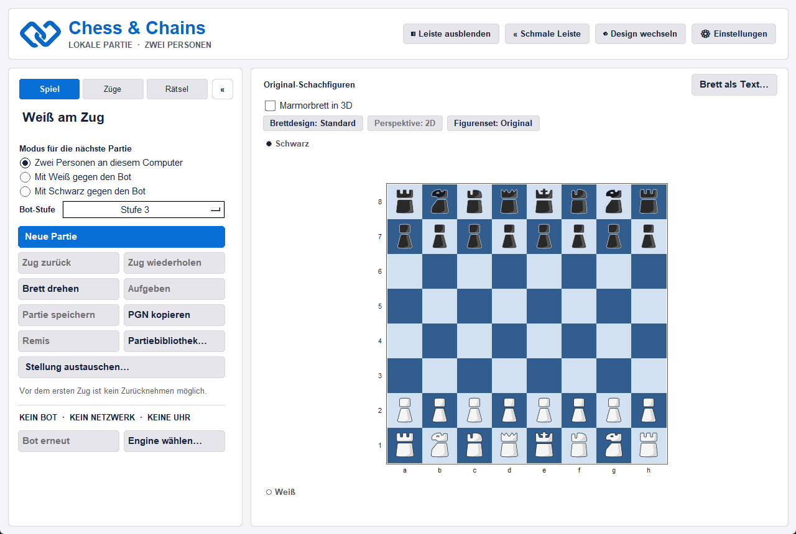
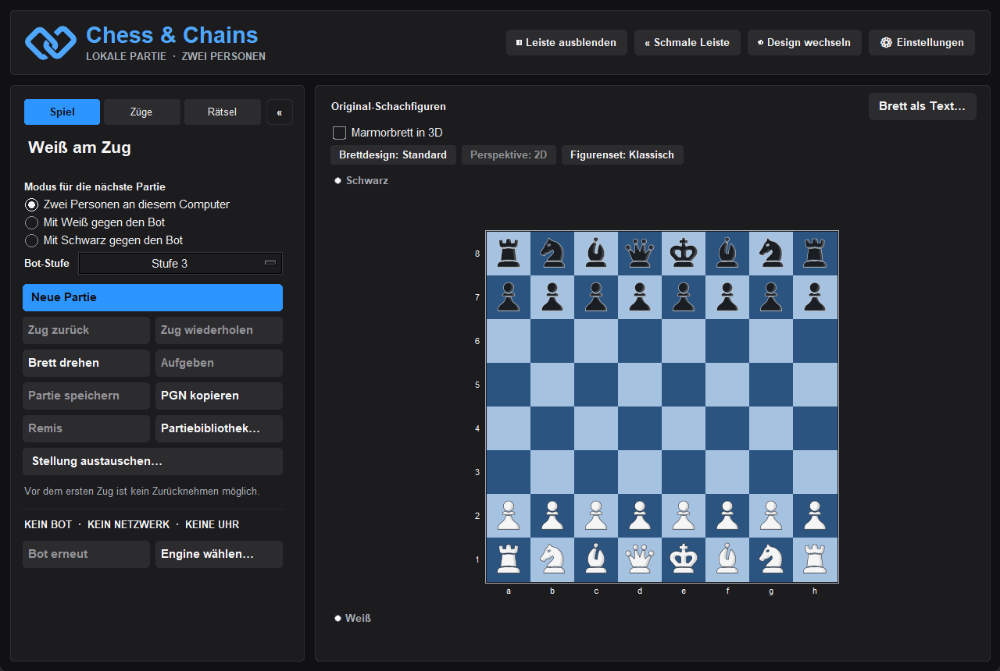
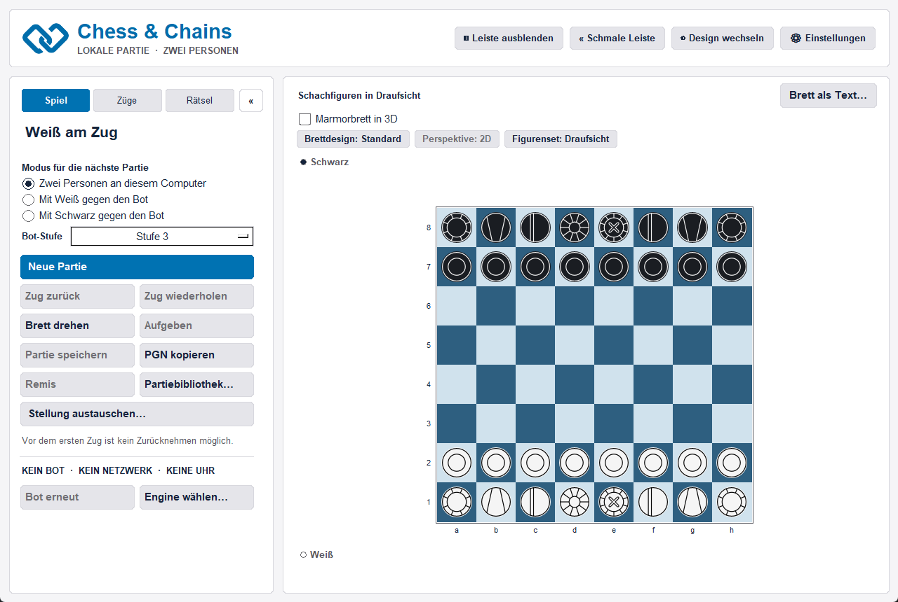
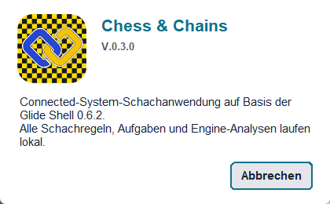

<p align="right"><a href="README.md">English</a> · <strong>Deutsch</strong></p>

<p align="center">
  
</p>

<h1 align="center">Chess &amp; Chains</h1>

<p align="center">
  <strong>Play. Think. Connect.</strong><br>
  Eine kostenlose, quelloffene und offlinefähige Desktop-Schach-App. Lokale Partien spielen, im Puzzle Lab trainieren und Brett, Figuren und Erscheinungsbild anpassen – ohne Konto und ohne Cloud.
</p>

<p align="center">
  
  
  <a href="LICENSE"></a>
  
  <a href="https://github.com/n05a-design/chess-and-chains/actions/workflows/checks.yml"></a>
</p>

<p align="center">
  <a href="#bildschirmfotos"><strong>Bildschirmfotos</strong></a> ·
  <a href="#entwicklerstart">Schnellstart</a> ·
  <a href="#geplanter-funktionsumfang">Funktionen</a> ·
  <a href="#was-bereits-vorhanden-ist">Projektstand</a> ·
  <a href="docs/roadmap/ROADMAP.md">Roadmap</a> ·
  <a href="CONTRIBUTING.md">Mitwirken</a> ·
  <a href="README.md">English</a>
</p>

<p align="center"><sub>V.0.3.0 · <a href="CHANGELOG.md">Änderungsverlauf</a> · <a href="docs/governance/GOVERNANCE.md#projektversion">Versionspflege</a> · <a href="START_HERE.md">Einstieg</a> · <a href="MANIFEST.md">Manifest</a> · <a href="docs/questions/OPEN_QUESTIONS.md">Offene Fragen</a></sub></p>

## Bildschirmfotos

Echte Aufnahmen der laufenden Tk-App (Entwicklungsstand V.0.3.0 mit den neuen Logos, Windows 11, Tk 9.0.4, 26.11.2026). Das Signet in der Kopfzeile übernimmt die gewählte Themenfarbe.

<p align="center">
  
  
</p>
<p align="center">
  
  
</p>

## Geplanter Funktionsumfang

- Offline gegen lokale UCI-Engines spielen, ohne Benutzerkonto oder Pflichtserver.
- Mehrere einstellbare Spielstärken und später unterschiedliche Bot-Charakteristiken.
- Lokale Rätselpakete mit **Lichess-Puzzle-Rating ab 1000**; das Rating ist nicht mit persönlicher Schach-Elo gleichzusetzen.
- Eigenes visuelles Erscheinungsbild mit modularen SVG-Figurensets, Brettdesigns und Themes.
- Lokale Partien, Trainingsverlauf, PGN/FEN und langfristig eine Taktik-Analyse.
- Windows und macOS zuerst, Linux nach gesonderter Qualitätssicherung.

GitHub ist der Entwicklungsort und beschreibt, wie das fertige Produkt funktionieren soll. Nach Fertigstellung und Freigabe erscheint die App auch auf GitHub und steht zusammen mit den anderen Programmen im hauseigenen Software-Katalog kostenlos zum Download bereit.

## Was bereits vorhanden ist

Der **GUI-freie Python-Regelkern** unterstützt legale Züge, FEN/SAN/PGN, Remisregeln und Rückgängig/Wiederholen. Die Tk-Desktop-Anwendung nutzt **Glide Shell 0.6.2** aus Glide `1.0.2` (Git-Tag `v1.0.2`, Commit `7dcd8dc04366f88943fa17827882cef4d81421b8`, MPL-2.0) unter `src/glide_shell/` als technisches Fundament (`AppHost`, `window_lifetime`, `modal_session`, `desktop_adapter`, `action_picker`, `window_geometry`, `system_appearance`, `motion`, `runtime_paths`, `command_history`, `text_fit`, `custom_controls`) bei voller Wahrung der Markenidentität **Connected System** (Light-/Dark-/System-Theme mit WCAG 2.2 AA Kontrast). Perft- und Golden-Tests decken die Umsetzung ab. Der Regelkern erkennt tote Stellungen in kurzen Zwangsfolgen zu Patt oder ungenügendem Material sowie geschlossene Bauernsperren, die kein König öffnen kann. Die allgemeine Erkennung und die Inhaberabnahme stehen aus.

Der lokale Tk-Prototyp umfasst folgende Funktionen.

- Partie für zwei Personen und **Bot-Modus** (Bot spielt Weiß oder Schwarz) über einen asynchronen Game-Controller,
- **Connected System** mit eigener Wortmarke, drei auswählbaren Figurensets (Original V.06, Draufsicht V.04.2, Klassisch V.05.1) als Original-SVGs (je 12 Einzelfiguren + PNG-Atlas-Fallback),
- UCI-Prozessadapter, getestet **nur mit einer projekteigenen Mock-Engine** – diese ist **keine Schach-KI**,
- sechs datengetriebenen Bot-Stufen (Optionen nur, wenn die Engine sie anbietet; Spielstärke **nicht kalibriert**),
- **Puzzle Lab** mit fünf projekteigenen Demo-Rätseln und Import eigener Paketordner. Unter **Rätselpakete…** lassen sich lokale Pakete öffnen. Die App merkt sich das zuletzt geöffnete Paket und speichert den Fortschritt je Paket. Der [Offline-Builder](data/puzzle_packs/README.md) verarbeitet CSV im Lichess-Format ab Rating 1000,
- Remisanspruch bei dreifacher Wiederholung oder nach der 50-Züge-Regel, auch durch Ansage eines legalen Zugs,
- lokaler SQLite-Speicherung für Rätselfortschritt und Partien. Die Partiebibliothek öffnet gespeicherte Partien im Zweispielermodus und übernimmt das PGN-Ergebnis. Bei neu gespeicherten Partien bleiben Aufgabe, Remisanspruch und ein eventuell angesagter Zug erhalten. Über die Bibliothek lässt sich pro Vorgang eine UTF-8-PGN-Datei importieren oder exportieren. Einstellungen liegen in JSON, die Oberfläche ist auf Deutsch und Englisch verfügbar.
- Stellungsaustausch unter „Spielen“ → „Stellung austauschen…“. Die aktuelle FEN steht beim Öffnen im Eingabefeld. Eine FEN lässt sich einfügen, kopieren oder als `.fen` öffnen und speichern. „Stellung spielen“ startet eine lokale Partie zu zweit ab dieser Position mit neuem Zugverlauf.

Der Inhaber hat die Original-SVG-Figuren unter MPL-2.0 freigegeben. Tk 9 zeichnet ihre SVGs direkt. Ältere Tk-Versionen verwenden die daraus erzeugte PNG-Grafiktafel. Die eigenen Brettdesigns, eine getestete echte Engine, das geplante Rätselangebot und ein Installer gehören zur weiteren Entwicklung.

Über „Brett als Text…“ lassen sich in Partien und Rätseln besetzte Felder
und legale Zielfelder als Listen lesen. Pfeiltasten wählen einen Eintrag.
Enter wechselt von der Figur zum Ziel und spielt den dort gewählten Zug.
Escape schließt das Textbrett.

In der Partiebibliothek können mehrere Suchbegriffe kombiniert werden,
etwa ein Spielername und eine Veranstaltung. Enter wechselt vom Suchfeld
zur Trefferliste. Öffnen und PGN-Export verwenden die ausgewählte Partie.

Im Rätsellabor zeigt „Lernstand“ alle Aufgaben, ungelöste Aufgaben oder
bereits versuchte Aufgaben ohne fehlerfreie Lösung. Pro Aufgabe bleiben
Versuchsanzahl, beste Lösungszeit und die Angaben zum letzten Versuch
lokal verfügbar.

„Rätsel neu starten“ setzt dieselbe Aufgabe auf die Startstellung nach dem
Aufbauzug zurück. Hinweise zeigen zuerst die Figur und dann das Zielfeld.
Unter „Züge“ oder in der Partiebibliothek öffnet „Partie nachspielen…“ eine
eigene Ansicht. Die Zugliste und die Links-/Rechts-Tasten wechseln die Stellung.

Über dem Brett schaltet **Marmorbrett in 3D** die schräge Marmoransicht
ein und aus. Beide Ansichten spielen dieselbe Partie. Die Ansicht
übernimmt Zugrechte, Orientierung, Zugliste und Rückgängig-Verlauf.

## Entwicklerstart

```bash
python -m unittest discover -s tests -v
python scripts/verify_starter.py
python -m pip install --no-build-isolation --no-deps -e .
python -m chess_and_chains --version
python -m chess_and_chains --headless-check
python -m chess_and_chains
```

Für einen sauberen Start außerhalb einer IDE oder eines Editors:

```bash
python3 start_chess_and_chains.py          # isoliert Bytecode-Cache und startet ohne PYTHONPATH
# oder per Doppelklick auf "Start Chess & Chains.command" im macOS-Finder
# oder als eigenständiges macOS-Bundle bauen und starten:
python3 packaging/macos/build_app.py && open "build/macos/Chess & Chains.app"
```

Nach einmaliger Installation (`pip install --no-build-isolation --no-deps -e .`) funktionieren `chess-and-chains` und `python3 -m chess_and_chains` zudem aus jedem Verzeichnis ohne `PYTHONPATH=src`.

Eine bereits lokal installierte UCI-Engine kann zur Entwicklung über `CHESS_AND_CHAINS_ENGINE=/pfad/zur/engine` oder *Engine-Einstellungen…* genutzt werden; die App lädt niemals Engines herunter. Der Standardaufruf öffnet den lokalen Tk-Prototyp; `--headless-check` prüft die Verfügbarkeit ohne Fenster. Für Tk-Unterstützung muss die Python-Installation Tk enthalten. Der Regeldomänenkern hat keine Laufzeitabhängigkeit auf eine Schachbibliothek.

*Engine testen* prüft den UCI-Handshake und wartet auf `readyok`. Bei Erfolg zeigt der Dialog den Namen und die Zahl der gemeldeten Optionen. Der Testlauf beendet seinen Prozess. Die Schaltfläche *Speichern* übernimmt den Pfad.

Mit Tk 9 lässt sich ein lokaler Brettentwurf für einen Programmaufruf in der App anzeigen. Beispiel: `python -m chess_and_chains --board-design assets/boards/source/board-template.svg`. Die [SVG-Lieferanleitung](assets/boards/source/README.md) beschreibt die Formate für Gesamtbretter und einzelne Felder.

`python -m chess_and_chains --piece-set original|top|classic` wählt das Figurenset für die Sitzung. `--piece-set original` (V.06, Vorderansicht-Design) ist der Standard. `--piece-set top` lädt die Draufsicht-Figuren (V.04.2) und `--piece-set classic` die klassischen Silhouetten (V.05.1). Das veraltete Argument `--piece-view top` bleibt unterstützt. Alle drei Sets nutzen [editierbare Einzel-SVGs](assets/chess_pieces/source_svg/README.md) und einen per-Set PNG-Atlas-Fallback für Tk ohne SVG-Unterstützung. Das Figurenset lässt sich auch zur Laufzeit im Dialog **Darstellung…** oder über das Menü wechseln.

Der [lokale 3D-Prototyp mit kühlem Marmor](app/marble_3d/README.md) startet
im Checkout mit `python app/marble_3d/server.py`. Zwei Personen spielen
am selben Gerät über den vorhandenen Regelkern. Die Partie lässt sich als
PGN speichern. [Editierbarer Spielsatz und Grafikstudien](design/source/marmor-3d/README.md)

## Lizenz

Eigene Quelltexte sind als **MPL-2.0** vorgesehen. Der W05-Regelkern wird eigenständig implementiert. **Stockfish ist GPLv3**, ebenso sind weitere Drittkomponenten separat zu prüfen. Eine vollständig gebündelte Offline-Distribution darf erst nach schriftlicher Lizenz- und Architekturentscheidung erfolgen. Die offiziellen Downloads sollen stets kostenlos bleiben; MPL/GPL verbieten Dritten jedoch keine entgeltliche Weitergabe.

[Rechte- und Lizenzstrategie](docs/legal/LICENSE_STRATEGY.md) · [Dritthinweise](THIRD_PARTY_NOTICES.md) · [Design-/Asset-Verzeichnis](docs/design/ASSET_REGISTER.csv) · [Copilot-Aufträge](prompts/README.md)

*Chess & Chains ist ein unabhängiges Projekt und nicht mit Lichess, Stockfish oder Drittanbietern verbunden.*
