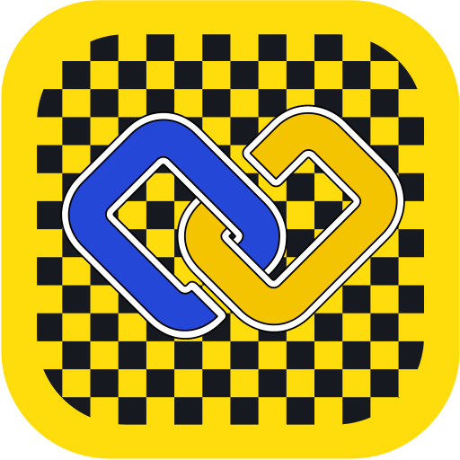
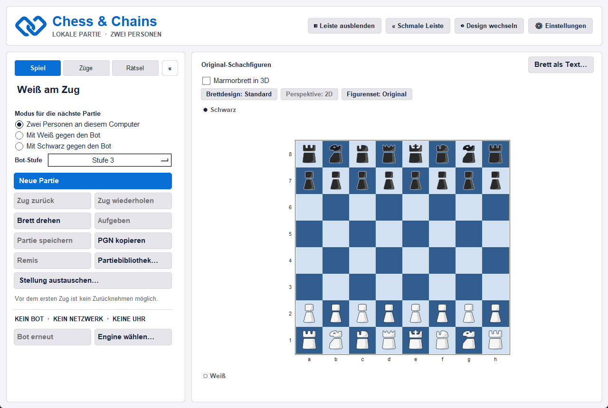
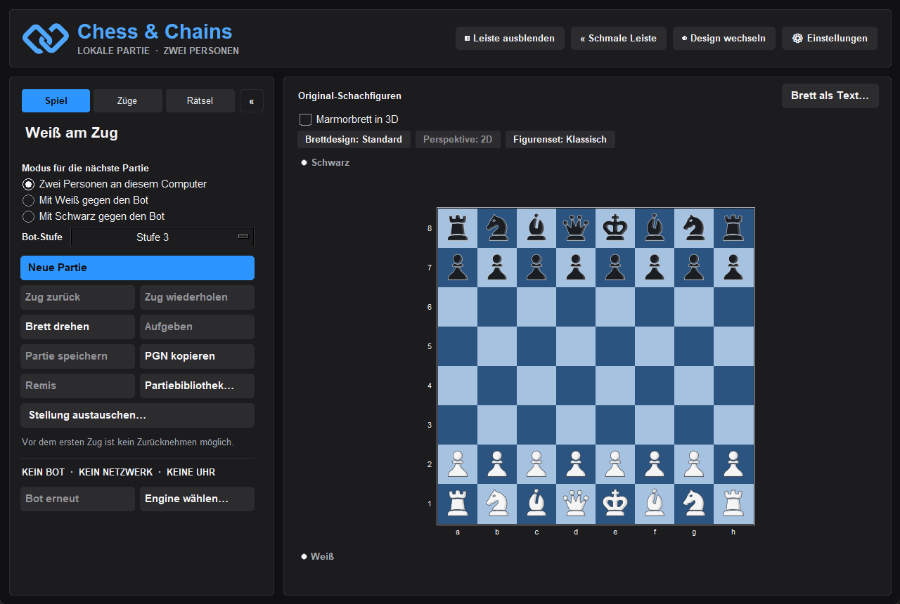
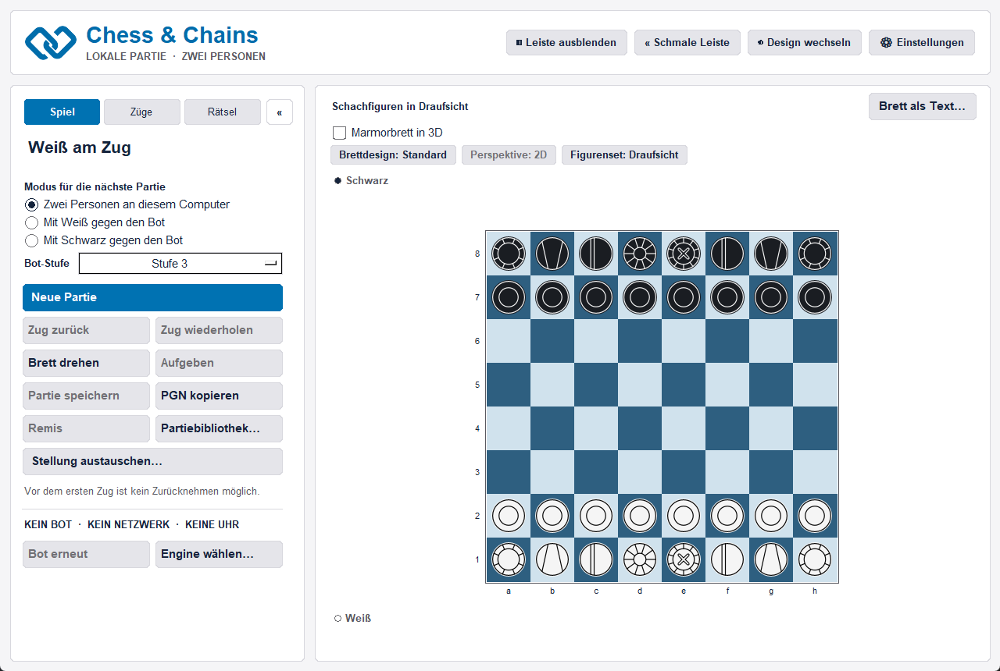
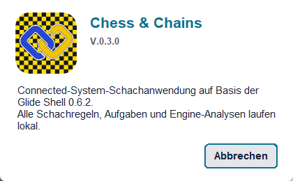

<p align="right"><strong>English</strong> · <a href="README.de.md">Deutsch</a></p>

<p align="center">
  
</p>

<h1 align="center">Chess &amp; Chains</h1>

<p align="center">
  <strong>Play. Think. Connect.</strong><br>
  A free, open-source, offline-first desktop chess app. Play local games, train with the Puzzle Lab and shape board, pieces and theme to your taste – no account, no cloud.
</p>

<p align="center">
  
  
  <a href="LICENSE"></a>
  
  <a href="https://github.com/n05a-design/chess-and-chains/actions/workflows/checks.yml"></a>
</p>

<p align="center">
  <a href="#screenshots"><strong>Screenshots</strong></a> ·
  <a href="#quick-start-for-contributors">Quick start</a> ·
  <a href="#product-direction">Features</a> ·
  <a href="#current-implementation-status">Project status</a> ·
  <a href="docs/roadmap/ROADMAP.md">Roadmap</a> ·
  <a href="CONTRIBUTING.md">Contributing</a> ·
  <a href="README.de.md">Deutsch</a>
</p>

<p align="center"><sub>V.0.3.0 · <a href="CHANGELOG.md">Changelog</a> · <a href="docs/governance/GOVERNANCE.md#projektversion">Versioning policy</a> · <a href="MANIFEST.md">Project manifest</a> · <a href="docs/questions/OPEN_QUESTIONS.md">Open questions</a></sub></p>

## Screenshots

Real screenshots of the running Tk app (V.0.3.0 development state with the new logos, Windows 11, Tk 9.0.4, 2026-11-26). The header signet takes the selected theme colour.

<p align="center">
  
  
</p>
<p align="center">
  
  
</p>

## Product direction

- **Play offline:** standard chess against locally controlled UCI engines; no required account or cloud service.
- **Choose your challenge:** selectable strength presets, with actual strength to be measured and calibrated.
- **Solve meaningful puzzles:** planned local tactical collections with a minimum **puzzle rating of 1000**, using legally sourced material.
- **Make the board your own:** original, modular SVG piece sets, boards and application themes.
- **Own your progress:** local game and puzzle history, optional PGN/FEN interoperability, privacy by design.
- **Work across desktops:** Windows and macOS are initial release targets; Linux is a subsequent acceptance target.

GitHub is the home of development and documents how the finished product is intended to work. Once the finished version is approved for release, it will be published on GitHub and offered as a free download in the owner's software catalogue alongside the other programs.

## Current implementation status

The local Tk desktop prototype supports two-player play, a project-owned mock engine and a demo Puzzle Lab. A tested real engine, the planned puzzle catalogue and an installer are future release work.

| Capability | Status |
| --- | --- |
| Product requirements, roadmap and documentation | Maintained; MVP contract and most ADRs are proposals awaiting owner decisions ([Roadmap](docs/roadmap/ROADMAP.md)) |
| Headless rules domain (legal moves, FEN/SAN/PGN, draw rules, undo/redo) | Perft and golden tests cover the implemented rules, including dead positions in short forced continuations into stalemate or insufficient material and closed pawn barriers that neither king can open. General dead-position detection and owner acceptance remain open. |
| Desktop board and local two-player UI | Tk prototype with Connected System branding; three selectable piece sets: Original V.06, Top-view V.04.2 and Classic V.05.1 (each 12 individual SVGs + PNG fallback atlas) |
| UCI process adapter | Implemented; tested only against a project-owned mock engine |
| Game controller + asynchronous bot (play as White or Black) | Implemented; tested with the mock engine, which is **not a chess AI** |
| Real engine (e.g. Stockfish) bot play | Not bundled, not tested; user-configured engine path supported but unverified (ADR-001 open) |
| Bot difficulty presets | Six data-driven presets; options only sent if the engine advertises them; strengths **not calibrated** |
| Draw claims | Claim threefold repetition or the 50-move rule in the current position or by declaring a legal move. |
| Puzzle Lab (importer, packs, solving) | Five project-authored demo puzzles. Import and open local folders from **Puzzle packs…**. The app restores the last pack and tracks progress separately. The [offline builder](data/puzzle_packs/README.md) enforces Rating ≥ 1000. |
| Local storage (SQLite games, puzzle progress, settings) | Save and reopen games in two-player mode, including local resignation and draw-claim details. Import or export one UTF-8 PGN file per action in the local library. |
| Library search | Combine terms to find saved games by player, event, result or game number. Open or export the selected result. |
| Puzzle review | Combine theme and rating with unsolved puzzles or attempts without a clean solve. See the attempt count, best solve time and latest result for each puzzle. |
| Puzzle retry and hints | Try the current puzzle again from its original setup. Reveal the moving piece and destination in two steps. |
| Game replay | Browse the played positions of the current game or a saved record in a separate board with a keyboard-operated move list. |
| 3D marble board | Use the switch above the game board to change between the normal board and a tilted marble view in the desktop window. The current game and undo/redo stay available. |
| Position exchange | Open “Position exchange…” in Play to paste, copy, open or save a FEN position. “Play position” starts a local two-player game from that position with a fresh move history. |
| Text board | Open “Board as text…” to browse occupied squares and legal destinations in games and puzzles. Use the arrow keys to select an entry, Enter to move from the piece to the target or play the move, and Escape to close. |
| English/German UI | Implemented catalogues with parity tests |
| Windows/macOS/Linux installers | Not implemented |
| WinGet / Homebrew distribution | Not published |

## Technology direction (subject to decisions)

Python desktop project with an original MPL-2.0 headless rules domain and a Tkinter/Tk desktop application built on **Glide Shell 0.6.2** (from Glide `1.0.2`, Git tag `v1.0.2`, Commit `7dcd8dc04366f88943fa17827882cef4d81421b8`, MPL-2.0) under `src/glide_shell/` (`AppHost`, `window_lifetime`, `modal_session`, `desktop_adapter`, `action_picker`, `window_geometry`, `system_appearance`, `motion`, `runtime_paths`, `command_history`, `text_fit`, `custom_controls`). The owner-approved original Connected System pieces render from SVG in Tk 9 and from a PNG atlas derived from those SVGs in older Tk versions. Light, dark, and system themes preserve WCAG 2.2 AA contrast. **Stockfish is GPLv3.** Bundling it with this app is gated by licensing review. See [License Strategy](docs/legal/LICENSE_STRATEGY.md).

## Quick start for contributors

Requires **Python 3.11+** with Tk support for the desktop prototype.

```sh
python -m unittest discover -s tests -v
python scripts/verify_starter.py
python -m pip install -e .
python -m chess_and_chains --version
python -m chess_and_chains --headless-check
python -m chess_and_chains
```

To try a locally installed UCI engine during development (never downloaded by the app), set `CHESS_AND_CHAINS_ENGINE=/path/to/engine` or use *Engine settings…* in the app. Without it, bot mode uses the clearly labelled mock engine.

*Test engine* waits for the UCI handshake and `readyok`, then displays the engine name and advertised option count. The test closes its process. Use *Save* to apply the path.

For a standalone desktop launch outside any IDE or editor:

```sh
python3 start_chess_and_chains.py          # isolates bytecode cache and starts without PYTHONPATH
# or double-click "Start Chess & Chains.command" in macOS Finder
# or build a standalone macOS .app bundle:
python3 packaging/macos/build_app.py && open "build/macos/Chess & Chains.app"
```

After `python -m pip install --no-build-isolation --no-deps -e .`, `chess-and-chains` and `python -m chess_and_chains` also work globally from any directory without `PYTHONPATH=src`. `--version` prints the project version without loading Tk, and `--headless-check` reports the available prototype features. The default command opens the local Tk prototype. The chess domain has no runtime chess-library dependency.

With Tk 9, preview a local vector board for one session with `python -m chess_and_chains --board-design assets/boards/source/board-template.svg`. The [SVG delivery guide](assets/boards/source/README.md) covers complete boards and collections of individual squares.

Run `python -m chess_and_chains --piece-set original|top|classic` to select a piece set for the session. `--piece-set original` (V.06, front-view design) is the default. `--piece-set top` loads the top-view pieces (V.04.2) and `--piece-set classic` loads the classic silhouette pieces (V.05.1). The legacy `--piece-view top` flag remains supported. All three sets use [editable individual SVGs](assets/chess_pieces/source_svg/README.md) and a per-set PNG atlas fallback for Tk without SVG support. The piece set can also be changed at runtime from the **Appearance…** dialog or the View menu.

Run `python app/marble_3d/server.py` from the checkout to open the
[local 3D marble board](app/marble_3d/README.md) for two players on one
device. It uses the same chess rules and exports games to PGN.
[Editable artwork and studies](design/source/marmor-3d/README.md)

## Licensing and third-party rights

Original starter source files are offered under [MPL-2.0](LICENSE). Engine binaries, libraries, fonts, artwork, puzzle data and third-party references may carry **separate terms**; nothing here grants rights to those materials. Official builds are intended to remain free of charge. Review [Third-Party Notices](THIRD_PARTY_NOTICES.md) and [Asset Register](docs/design/ASSET_REGISTER.csv) before redistribution. This repo is **not affiliated with Stockfish, Lichess or other chess services**.

## Project and development

- [Work orders and dependency gates](docs/roadmap/WORK_PACKAGES.md)
- [GitHub Copilot prompts](prompts/README.md)
- [Technical architecture](docs/architecture/ARCHITECTURE.md)
- [Competition research](docs/research/COMPETITOR_ANALYSIS.md)
- [Design and branding brief](docs/design/DESIGN_SYSTEM_BRIEF.md)
- [GitHub release strategy](docs/release/RELEASE_STRATEGY.md)

*Connected System is the owner-selected visual direction. Release and individual asset approvals are tracked in [ADR‑005](docs/decisions/ADR-005_BRAND_ASSETS.md).*
